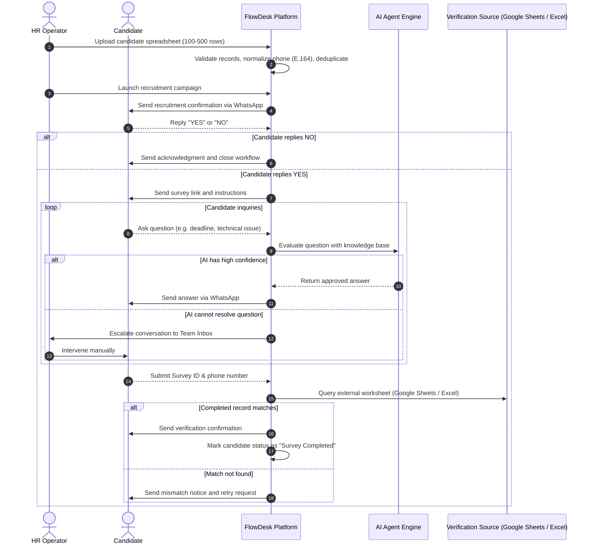

# Product requirements document

## Executive summary

FlowDesk is an internal WhatsApp automation platform designed for company operations. The platform enables non-technical employees to import contact records, execute structured communication campaigns, orchestrate multi-step interactive workflows, provide automated responses through an AI assistant, and hand off conversations to human operators in a centralized team inbox.

The initial target use case is candidate recruitment and survey verification. The underlying workflow engine and messaging infrastructure remain domain-agnostic to support onboarding, internal surveys, event registrations, and document collection.

## User personas

### Human resources coordinator (Campaign operator)
- Imports candidate lists from spreadsheets (100 to 500 rows).
- Configures column mappings and initiates campaign dispatches.
- Tracks dispatch metrics, delivery rates, and survey completion status.

### Support agent (Inbox operator)
- Monitors active conversations in the shared team inbox.
- Receives automated alerts when candidate inquiries require human intervention.
- Takes over conversations from the AI assistant and sends direct WhatsApp messages.

### System administrator
- Manages user accounts and role-based permissions.
- Configures messaging provider credentials and external API connections.
- Reviews system audit logs and health metrics.

### External candidate (End user)
- Receives WhatsApp notifications regarding application status.
- Responds with confirmation keywords (for example: YES or NO).
- Submits survey details and asks clarifying questions answered by the AI bot.

## Core business workflow: recruitment and survey automation

## Functional requirements by module

### 1. Authentication and users
- Support email and password authentication with bcrypt hashing.
- Issue JSON Web Tokens (access token short-lived, refresh token persisted in secure HTTP-only cookies or store).
- Support three roles: `admin`, `manager`, `agent`.
- Enforce role-based access control (RBAC) on all protected routes.

### 2. Contacts and contact lists
- Import contacts via CSV and Excel (`.xlsx`, `.xls`) files up to 1,000 rows per batch.
- Provide interactive column mapping (map source columns to standard fields: `firstName`, `lastName`, `phone`, `email`, and dynamic `customFields`).
- Validate and normalize phone numbers into E.164 standard format.
- Detect duplicates within the import batch and against the existing database.
- Allow operators to tag contacts and segment them into target lists.

### 3. Campaign management
- Create campaigns linked to a contact list and a workflow definition.
- Schedule immediate or delayed campaign execution.
- Maintain campaign execution statuses: `draft`, `scheduled`, `running`, `paused`, `completed`, `cancelled`.
- Track real-time campaign counters: `totalContacts`, `messagesSent`, `messagesDelivered`, `messagesRead`, `repliesReceived`, `conversions`, `failures`.

### 4. Messaging abstraction
- Define an agnostic interface `IMessagingProvider` for sending texts, media, and interactive templates.
- Support `MockWhatsAppProvider` for testing without WhatsApp Business credentials.
- Provide a webhook receiver pipeline for incoming messages, delivery reports (`sent`, `delivered`, `read`), and failure notices.
- Support `MetaWhatsAppProvider` conforming to WhatsApp Cloud API standards.

### 5. Conversations and team inbox
- Aggregate messages into unified contact-level conversations.
- Support conversation status flags: `bot`, `human_needed`, `agent_assigned`, `closed`.
- Enable agent assignment and transfer between operators.
- Broadcast incoming messages and status changes via Socket.IO for real-time collaboration.
- Maintain full audit trails of agent interventions and notes.

### 6. Workflow management and execution engine
- Model workflows as directed step graphs with explicit triggers, actions, and branch conditions.
- Step types:
  - `send_message`: Dispatches WhatsApp message templates or plain text.
  - `wait_for_reply`: Pauses execution until an incoming message arrives or a timeout expires.
  - `condition`: Evaluates contact attributes or reply content using pattern matching and boolean operators.
  - `delay`: Delays subsequent execution by a specified duration.
  - `verify_data`: Triggers an external lookup adapter (Google Sheets via Google Drive API, Microsoft Graph Excel Online, or internal database).
  - `update_record`: Updates contact fields, tags, or campaign enrollment status.
  - `ai_conversation`: Engages the AI conversational agent for Q&A while maintaining the active state.
  - `human_handoff`: Escalate the thread to human operators and pause automated progress.
  - `terminate`: Ends the workflow instance with an explicit outcome state (`completed`, `failed`, `opted_out`).
- Persist workflow execution state per contact in MongoDB.
- Schedule asynchronous steps using BullMQ queues backed by Redis.
- Guarantee idempotent step execution via deterministic step run keys.

### 7. AI agent engine
- Parse inbound candidate queries during active workflow states.
- Resolve user intent and answer frequently asked questions using approved knowledge base items.
- Run deterministic tool calls to retrieve status or verify survey submissions.
- Prevent arbitrary modifications to database records by restricting tool execution to validated backend services.
- Detect escalation triggers (explicit candidate request for an agent, sentiment thresholds, or low confidence scores) and execute handoff.
- Provide a `MockAIProvider` for local testing without external LLM keys.

### 8. Knowledge base
- Store reference documents, policies, FAQs, and survey instructions grouped by category.
- Support keyword and semantic vector search for context retrieval.
- Provide administrative endpoints to create, edit, activate, or archive entries.

### 9. External integrations & spreadsheet verification
- Google Sheets API integration to inspect survey response sheets hosted on Google Drive.
- Microsoft Graph API integration to inspect Excel Online workbooks in OneDrive or SharePoint.
- Internal database verification lookup for directly connected submission tables or collections.
- Query specified worksheet ranges to locate candidate survey records by phone number or Survey ID.
- Provide a local mock integration mode using test fixtures for development and automated testing.

### 10. Analytics and reporting
- Aggregate delivery, read, and conversion rates across campaigns.
- Track workflow completion funnels and drop-off points.
- Measure AI resolution rates and human escalation volume.

### 11. Audit logs
- Log all administrative and operational events: user login, campaign launch, manual message dispatch, agent takeover, contact import.
- Store timestamp, user ID, action name, target entity, IP address, and payload diffs.

## Non-functional requirements

### Performance and scalability
- Import and validate 500 spreadsheet rows in under 3 seconds.
- Support asynchronous dispatch of 500 messages with configurable rate limiting (default: 10 to 30 messages per second) to prevent provider throttling.
- Process incoming webhooks and dispatch workflow events within 200 milliseconds.

### Reliability and fault tolerance
- Isolate workflow failures to individual contact executions; a single failed step must not stall the campaign.
- Retry failed external API calls (WhatsApp dispatch, Microsoft Graph) up to 3 times with exponential backoff.
- Persist all webhook events before asynchronous processing to prevent data loss during restarts.

### Usability and accessibility
- Single-page interface built with React 19 and Tailwind CSS.
- Responsive design supporting desktop resolutions (1280px and above) for multi-column inbox workflows.
- Real-time updates without manual browser refreshes.

### Security and compliance
- Store all passwords using bcrypt with a salt work factor of 12.
- Protect all API endpoints against cross-site scripting (XSS), cross-site request forgery (CSRF), and injection attacks.
- Secure environment secrets; no API keys or database connection strings in source code.

