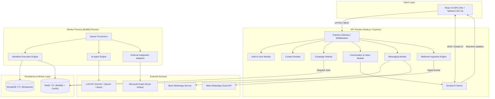
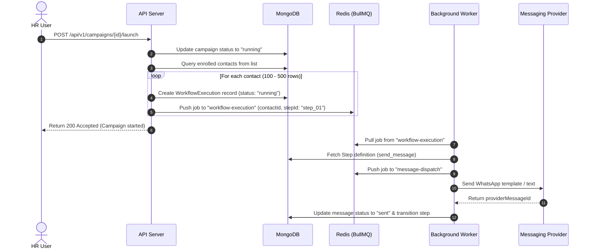
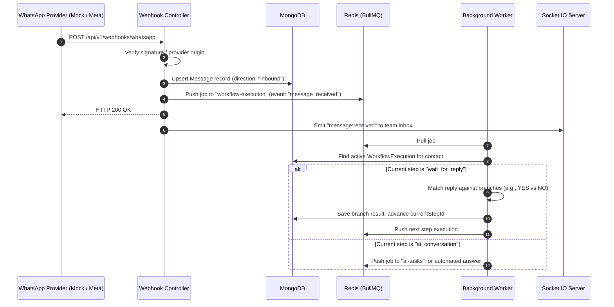
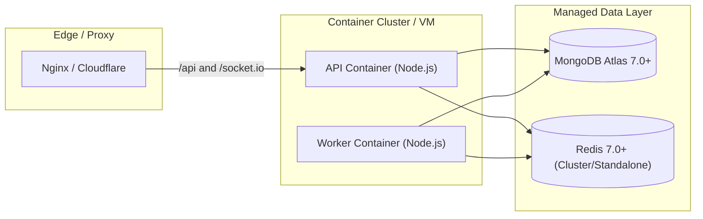

# System architecture

## Architecture style

FlowDesk uses a modular monolith architecture. The application deploys as two Node.js runtime instances: an HTTP/WebSocket API service and a dedicated background worker service. Both runtimes share a single domain model, database, and Redis cache.

This pattern provides operational simplicity for a solo developer while maintaining clean module boundaries that prevent coupling.

## Module boundaries and responsibilities

| Module | Core responsibilities | Inbound dependencies | Outbound dependencies |
|---|---|---|---|
| `auth` | User registration, authentication, JWT tokens, RBAC guard | API Gateway | MongoDB |
| `contacts` | CSV/Excel ingestion, E.164 normalization, deduplication, contact tagging | API Gateway, Campaign Module | MongoDB |
| `campaigns` | Campaign lifecycle, target segmentation, dispatch scheduling, counters | API Gateway, Workflow Module | Contacts, MongoDB, Redis (BullMQ) |
| `messaging` | Provider abstraction, dispatch rate limiting, status tracking | Campaigns, Conversations, Workflow | Redis, MockWA, MetaWA, MongoDB |
| `whatsapp` | Meta Cloud API format translation, webhook HMAC validation | Messaging, Webhook Gateway | Meta WhatsApp API |
| `conversations` | Thread aggregation, agent assignment, human takeover, Socket.IO broadcast | Webhook Gateway, Messaging, AI Engine | SocketServer, MongoDB |
| `workflow` | DAG definition, step execution, condition evaluation, state transitions | Campaigns, Webhook Gateway, Worker | Contacts, Messaging, AI, Integrations, MongoDB, Redis |
| `ai-agent` | Prompt construction, intent detection, knowledge retrieval, tool execution | Workflow, Worker | Knowledge Base, Integrations, LLM Providers |
| `knowledge-base` | FAQ storage, policy articles, retrieval indexing | AI Agent, API Gateway | MongoDB |
| `integrations` | Microsoft Graph API client, Excel Online reader, local mock fixture loader | Workflow, AI Agent | Microsoft Graph API, MongoDB |
| `analytics` | Metrics aggregation, funnel statistics, export generation | API Gateway | MongoDB |
| `audit` | Administrative event logging, payload diffing | All Modules | MongoDB |

## Runtime processes

### 1. API server process (`server.js`)
- Exposes RESTful endpoints on port `5000`.
- Terminates TLS or runs behind a reverse proxy.
- Hosts the Socket.IO server on the same HTTP listener.
- Handles synchronous user interactions: authentication, contact uploads, manual messaging, campaign definitions.
- Receives inbound WhatsApp webhooks, validates signatures, stores raw event payloads, and immediately pushes jobs to BullMQ queues (`HTTP 200 OK` returned within 50ms).

### 2. Worker process (`worker.js`)
- Runs as an independent Node.js process executing BullMQ queue consumers.
- Manages concurrency, rate limits, delays, and retries.
- Consumes from 4 primary queues:
  - `message-dispatch`: Controls outbound message pacing (e.g. 20 messages/second) to satisfy WhatsApp rate limits.
  - `workflow-execution`: Advances execution steps for contacts, evaluates conditions, and runs actions.
  - `integration-sync`: Executes external network requests against Microsoft Graph API.
  - `ai-tasks`: Handles LLM generation calls asynchronously without tying up API HTTP threads.

## Real-time communication layer

Socket.IO enables real-time synchronization between the backend and browser clients.

### Connection handling
- Authenticated via JWT token passed in the `auth.token` handshake parameter.
- Connections without a valid JWT are rejected immediately.

### Room structure
- `user:<userId>`: Personal notifications, direct mentions, task completions.
- `conversation:<conversationId>`: Active chat updates, typing indicators, read receipts.
- `inbox:team`: Global inbox updates for agents (new incoming messages, escalation alerts, unassigned counts).
- `campaign:<campaignId>`: Live progress counters (sent, delivered, failed, response rates).

### Core real-time events

| Event name | Direction | Payload contents | Target room |
|---|---|---|---|
| `message:received` | Server -> Client | Message entity, conversation summary | `conversation:<id>`, `inbox:team` |
| `message:status_updated` | Server -> Client | Message ID, status (`sent`, `delivered`, `read`, `failed`) | `conversation:<id>` |
| `conversation:assigned` | Server -> Client | Conversation ID, assigned user object | `inbox:team`, `user:<id>` |
| `conversation:escalated` | Server -> Client | Conversation ID, reason, contact info | `inbox:team` |
| `campaign:progress` | Server -> Client | Campaign ID, stats counter snapshot | `campaign:<id>` |

## Data flow diagrams

### Outbound campaign dispatch flow

### Inbound webhook and workflow progression

## Deployment topology

### Process isolation rules
1. API instances never execute long-running loops, document parsing jobs, or synchronous LLM requests.
2. Worker instances never bind to public HTTP ports.
3. Node process crashes in workers do not impact API responsiveness.
4. Scale workers horizontally by adding container instances listening to the same BullMQ Redis queues.

