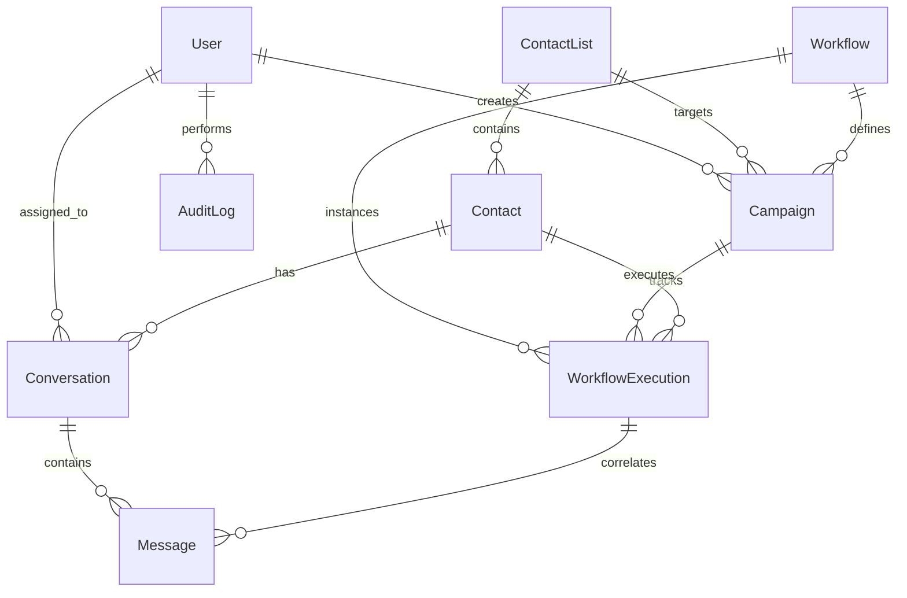

# Database schema

## Schema architecture

FlowDesk uses MongoDB with Mongoose ODM. Schemas enforce strict type definitions, validation rules, default timestamps, and compound indexing optimized for high-throughput message ingestion and workflow state retrieval.



## Collections and entity definitions

### 1. `users`
Represents internal operators, managers, and administrators.

```typescript
interface IUser {
  _id: ObjectId;
  name: string;
  email: string;
  passwordHash: string;
  role: 'admin' | 'manager' | 'agent';
  isActive: boolean;
  avatarUrl?: string;
  lastLoginAt?: Date;
  createdAt: Date;
  updatedAt: Date;
}
```

#### Fields and validation
- `name`: String, required, trimmed, min length 2, max length 100.
- `email`: String, required, unique, lowercase, trimmed, valid email format.
- `passwordHash`: String, required (excluded from default JSON queries).
- `role`: String, enum: `['admin', 'manager', 'agent']`, default: `'agent'`.
- `isActive`: Boolean, default: `true`.
- `avatarUrl`: String, optional.
- `lastLoginAt`: Date, optional.

#### Indexes
- `{ email: 1 }` (unique).
- `{ role: 1, isActive: 1 }`.

---

### 2. `contacts`
Stores external recipients, normalizes contact identifiers, and records opt-in state.

```typescript
interface IContact {
  _id: ObjectId;
  phone: string; // E.164 formatted string (+1234567890)
  firstName?: string;
  lastName?: string;
  email?: string;
  contactListIds: ObjectId[];
  tags: string[];
  customFields: Record<string, any>;
  optInStatus: 'opted_in' | 'opted_out' | 'unknown';
  optInUpdatedAt?: Date;
  lastInteractionAt?: Date;
  createdAt: Date;
  updatedAt: Date;
}
```

#### Fields and validation
- `phone`: String, required, unique, normalized to E.164 (e.g. `^\+[1-9]\d{1,14}$`).
- `firstName`: String, optional, max 100 chars.
- `lastName`: String, optional, max 100 chars.
- `email`: String, optional, lowercase, max 150 chars.
- `contactListIds`: Array of `ObjectId` referencing `contact_lists`.
- `tags`: Array of strings (indexed).
- `customFields`: Schema.Types.Mixed (stores un-modeled spreadsheet columns e.g. `roleApplied`, `sourceJobId`).
- `optInStatus`: String, enum: `['opted_in', 'opted_out', 'unknown']`, default: `'opted_in'`.
- `optInUpdatedAt`: Date, optional.
- `lastInteractionAt`: Date, optional.

#### Indexes
- `{ phone: 1 }` (unique).
- `{ contactListIds: 1 }`.
- `{ tags: 1 }`.
- `{ optInStatus: 1 }`.

---

### 3. `contact_lists`
Logical grouping of contacts originating from spreadsheet uploads or manual segments.

```typescript
interface IContactList {
  _id: ObjectId;
  name: string;
  description?: string;
  sourceType: 'csv_upload' | 'excel_upload' | 'manual' | 'api';
  originalFileName?: string;
  totalCount: number;
  validCount: number;
  duplicateCount: number;
  errorCount: number;
  createdById: ObjectId;
  createdAt: Date;
  updatedAt: Date;
}
```

#### Indexes
- `{ name: 1 }`.
- `{ createdById: 1, createdAt: -1 }`.

---

### 4. `campaigns`
Manages outbound broadcast workflows against designated contact lists.

```typescript
interface ICampaign {
  _id: ObjectId;
  name: string;
  description?: string;
  workflowId: ObjectId;
  contactListId: ObjectId;
  status: 'draft' | 'scheduled' | 'running' | 'paused' | 'completed' | 'cancelled';
  scheduledAt?: Date;
  startedAt?: Date;
  completedAt?: Date;
  stats: {
    totalContacts: number;
    dispatched: number;
    delivered: number;
    read: number;
    replied: number;
    converted: number;
    failed: number;
  };
  throttleRatePerSecond: number; // default: 20
  createdById: ObjectId;
  createdAt: Date;
  updatedAt: Date;
}
```

#### Indexes
- `{ status: 1, scheduledAt: 1 }`.
- `{ createdById: 1, createdAt: -1 }`.
- `{ workflowId: 1 }`.

---

### 5. `workflows`
Defines the reusable state machine / DAG execution model.

```typescript
interface IWorkflowNode {
  id: string; // unique node id within workflow (e.g. 'step_1')
  type: 
    | 'trigger'
    | 'send_message'
    | 'wait_for_reply'
    | 'condition'
    | 'delay'
    | 'verify_data'
    | 'update_record'
    | 'ai_conversation'
    | 'human_handoff'
    | 'terminate';
  name: string;
  config: Record<string, any>;
  nextStepId?: string; // default forward edge
  branches?: Array<{
    conditionType: 'equals' | 'regex' | 'contains' | 'default';
    conditionValue?: string;
    targetStepId: string;
  }>;
}

interface IWorkflow {
  _id: ObjectId;
  name: string;
  description?: string;
  version: number;
  isPublished: boolean;
  nodes: IWorkflowNode[];
  createdById: ObjectId;
  createdAt: Date;
  updatedAt: Date;
}
```

#### Indexes
- `{ name: 1, version: -1 }`.
- `{ isPublished: 1 }`.

---

### 6. `workflow_executions`
Maintains execution state for a single contact running through an active workflow.

```typescript
interface IWorkflowExecutionLog {
  stepId: string;
  stepType: string;
  status: 'started' | 'completed' | 'failed' | 'skipped';
  inputPayload?: any;
  outputPayload?: any;
  error?: string;
  timestamp: Date;
}

interface IWorkflowExecution {
  _id: ObjectId;
  workflowId: ObjectId;
  campaignId: ObjectId;
  contactId: ObjectId;
  status: 'running' | 'waiting_for_reply' | 'delayed' | 'completed' | 'failed' | 'paused_for_human';
  currentStepId: string;
  variables: Record<string, any>; // workflow runtime context
  stepLogs: IWorkflowExecutionLog[];
  waitingForReplyUntil?: Date;
  delayUntil?: Date;
  errorDetails?: string;
  retryCount: number;
  createdAt: Date;
  updatedAt: Date;
}
```

#### Indexes
- `{ campaignId: 1, contactId: 1 }` (unique compound index).
- `{ status: 1, waitingForReplyUntil: 1 }`.
- `{ status: 1, delayUntil: 1 }`.
- `{ contactId: 1, status: 1 }`.

---

### 7. `conversations`
Aggregates WhatsApp messaging history between a contact and the platform into a live thread.

```typescript
interface IConversation {
  _id: ObjectId;
  contactId: ObjectId;
  channel: 'whatsapp';
  assignedUserId?: ObjectId;
  status: 'bot' | 'human_needed' | 'agent_assigned' | 'closed';
  lastMessageAt?: Date;
  lastMessagePreview?: string;
  unreadCount: number;
  activeCampaignId?: ObjectId;
  tags: string[];
  createdAt: Date;
  updatedAt: Date;
}
```

#### Indexes
- `{ contactId: 1 }` (unique compound index for single open conversation per contact).
- `{ status: 1, lastMessageAt: -1 }`.
- `{ assignedUserId: 1, status: 1 }`.
- `{ lastMessageAt: -1 }`.

---

### 8. `messages`
Individual message records covering both inbound candidate messages and outbound platform dispatches.

```typescript
interface IMessage {
  _id: ObjectId;
  conversationId: ObjectId;
  contactId: ObjectId;
  campaignId?: ObjectId;
  workflowExecutionId?: ObjectId;
  direction: 'inbound' | 'outbound';
  senderType: 'system' | 'agent' | 'contact' | 'ai';
  senderUserId?: ObjectId;
  provider: 'mock' | 'meta';
  providerMessageId?: string;
  type: 'text' | 'template' | 'interactive' | 'image' | 'document';
  content: {
    body?: string;
    templateName?: string;
    templateParams?: Record<string, any>;
    mediaUrl?: string;
    interactiveData?: Record<string, any>;
  };
  status: 'queued' | 'sent' | 'delivered' | 'read' | 'failed';
  errorMessage?: string;
  rawWebhookPayload?: any;
  sentAt?: Date;
  deliveredAt?: Date;
  readAt?: Date;
  createdAt: Date;
  updatedAt: Date;
}
```

#### Indexes
- `{ conversationId: 1, createdAt: 1 }`.
- `{ providerMessageId: 1 }` (sparse index for fast webhook status updates).
- `{ contactId: 1, createdAt: -1 }`.
- `{ status: 1, createdAt: 1 }`.

---

### 9. `knowledge_bases`
Approved answers, policies, and survey documentation referenced by the AI Assistant.

```typescript
interface IKnowledgeArticle {
  _id: ObjectId;
  category: 'recruitment' | 'survey' | 'onboarding' | 'general';
  title: string;
  content: string;
  keywords: string[];
  isActive: boolean;
  version: number;
  createdById: ObjectId;
  createdAt: Date;
  updatedAt: Date;
}
```

#### Indexes
- `{ category: 1, isActive: 1 }`.
- `{ keywords: 1 }`.
- `{ title: 'text', content: 'text' }` (text search index).

---

### 10. `integrations`
Credentials and configurations for external systems (e.g. Microsoft 365 Graph API).

```typescript
interface IIntegration {
  _id: ObjectId;
  provider: 'microsoft_graph' | 'custom_webhook';
  name: string;
  status: 'active' | 'error' | 'unconfigured';
  config: {
    tenantId?: string;
    clientId?: string;
    clientSecretEncrypted?: string;
    driveId?: string;
    workbookItemId?: string;
    worksheetName?: string;
    [key: string]: any;
  };
  lastSyncAt?: Date;
  lastErrorMessage?: string;
  createdAt: Date;
  updatedAt: Date;
}
```

#### Indexes
- `{ provider: 1 }` (unique per provider configuration if single tenant).

---

### 11. `audit_logs`
Chronological, append-only record of administrative actions.

```typescript
interface IAuditLog {
  _id: ObjectId;
  userId?: ObjectId;
  userEmail?: string;
  action: string; // e.g. 'campaign.create', 'contact.import', 'inbox.takeover'
  entityType: string; // e.g. 'Campaign', 'Contact', 'Conversation'
  entityId?: ObjectId;
  ipAddress?: string;
  userAgent?: string;
  diff?: {
    before?: any;
    after?: any;
  };
  createdAt: Date;
}
```

#### Indexes
- `{ entityType: 1, entityId: 1, createdAt: -1 }`.
- `{ userId: 1, createdAt: -1 }`.
- `{ action: 1, createdAt: -1 }`.

