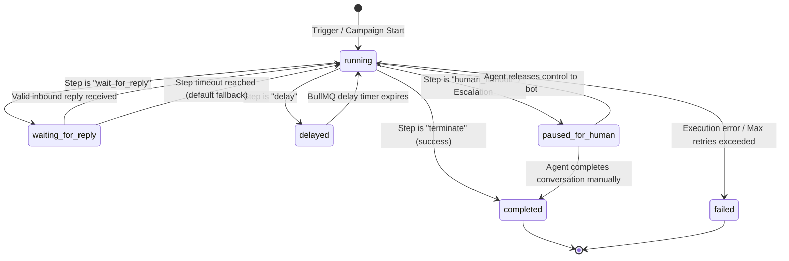

# Workflow engine specification

## Engine overview

The workflow engine executes business processes on a per-contact basis. Each execution tracks its own state machine, variable storage, step history, and timeout listeners in MongoDB.

The engine executes asynchronously using BullMQ job queues backed by Redis. Workflows are decoupled from specific communication channels and AI implementations.

## State machine



## Step node specifications

### 1. `trigger`
- Initiates the execution for a contact.
- Supported trigger types: `campaign_launch`, `contact_created`, `inbound_keyword`.
- Config schema:
  ```json
  {
    "triggerType": "campaign_launch"
  }
  ```

### 2. `send_message`
- Dispatches an outbound WhatsApp message.
- Supports template or raw text with variable interpolation using Handlebars syntax: `{{firstName}}`, `{{customFields.jobTitle}}`.
- Config schema:
  ```json
  {
    "messageType": "template",
    "templateName": "recruitment_confirmation_v1",
    "language": "en",
    "variables": {
      "1": "{{firstName}}",
      "2": "{{customFields.roleApplied}}"
    }
  }
  ```
- Progression: Advances to `nextStepId` immediately after message queue dispatch.

### 3. `wait_for_reply`
- Halts execution and transitions status to `waiting_for_reply`.
- Sets `waitingForReplyUntil` timestamp in MongoDB.
- Schedules a BullMQ delayed job for timeout evaluation.
- Config schema:
  ```json
  {
    "timeoutMinutes": 1440,
    "timeoutNextStepId": "step_followup_reminder",
    "branches": [
      {
        "conditionType": "regex",
        "conditionValue": "^(yes|y|yeah|interested)$",
        "targetStepId": "step_send_survey_link"
      },
      {
        "conditionType": "regex",
        "conditionValue": "^(no|n|nope|not interested)$",
        "targetStepId": "step_opt_out_ack"
      },
      {
        "conditionType": "default",
        "targetStepId": "step_clarification_loop"
      }
    ]
  }
  ```
- Resume condition: Inbound webhook matching contact phone triggers `WorkflowExecutionService.handleReply()`.

### 4. `condition`
- Evaluates contact properties or execution variables using deterministic comparisons.
- Operators supported: `equals`, `not_equals`, `contains`, `greater_than`, `less_than`, `is_empty`.
- Config schema:
  ```json
  {
    "variablePath": "variables.surveyVerified",
    "operator": "equals",
    "expectedValue": true,
    "trueStepId": "step_mark_complete",
    "falseStepId": "step_request_survey_retry"
  }
  ```

### 5. `delay`
- Pauses the workflow for a designated duration.
- Enqueues a delayed job in BullMQ queue `workflow-execution`.
- Config schema:
  ```json
  {
    "durationUnit": "hours",
    "durationValue": 24,
    "nextStepId": "step_check_submission"
  }
  ```

### 6. `verify_data`
- Calls an external integration adapter synchronously or with short retry logic.
- Config schema for Excel Online / Microsoft Graph:
  ```json
  {
    "integrationType": "microsoft_graph_excel",
    "action": "lookup_row",
    "query": {
      "phone": "{{contact.phone}}",
      "surveyId": "{{variables.candidateSurveyId}}"
    },
    "resultVariable": "variables.surveyVerified",
    "onSuccessStepId": "step_send_congratulations",
    "onFailureStepId": "step_notify_survey_missing"
  }
  ```

### 7. `update_record`
- Modifies contact attributes, tags, or execution context.
- Config schema:
  ```json
  {
    "target": "contact",
    "operations": [
      { "action": "add_tag", "value": "recruitment_confirmed" },
      { "action": "set_field", "path": "customFields.surveyStatus", "value": "COMPLETED" }
    ],
    "nextStepId": "step_final_ack"
  }
  ```

### 8. `ai_conversation`
- Activates conversational context for the contact. While in this step, incoming messages outside explicit branch keywords pass to the AI Agent Engine for auto-answering.
- Config schema:
  ```json
  {
    "knowledgeCategory": "recruitment",
    "enableToolCalling": true,
    "maxTurns": 10,
    "handoffThreshold": 0.65,
    "nextStepId": "step_survey_verification"
  }
  ```

### 9. `human_handoff`
- Suspends automated workflow processing.
- Updates Conversation status to `human_needed`.
- Broadcasts real-time alert via Socket.IO room `inbox:team`.
- Config schema:
  ```json
  {
    "reason": "candidate_requested_agent",
    "internalNote": "Candidate requested human agent during survey submission step."
  }
  ```

### 10. `terminate`
- Marks the workflow execution as `completed` or `failed`.
- Config schema:
  ```json
  {
    "outcome": "completed",
    "reason": "Survey successfully verified and candidate notified"
  }
  ```

## BullMQ queue and job topology

The engine utilizes two primary queues in Redis:

### 1. `workflow-execution`
Processes step execution jobs:
- `step:execute`: Evaluates and runs a designated step for an execution record.
- `step:timeout`: Checks if a `wait_for_reply` step has timed out; advances along `timeoutNextStepId`.
- `workflow:resume`: Triggered by inbound message or human handoff release.

### 2. `message-dispatch`
Buffers outbound WhatsApp requests with a token-bucket rate limiter:
- Rate limit: 20 jobs/second per provider key.
- Job attributes: `toPhone`, `messageType`, `content`, `metadata`.

## Idempotency and concurrency control

### Atomic state transitions
Execution records use atomic updates with status preconditions:
```javascript
const updatedExecution = await WorkflowExecution.findOneAndUpdate(
  {
    _id: executionId,
    status: 'waiting_for_reply',
    currentStepId: expectedStepId
  },
  {
    $set: {
      status: 'running',
      'variables.lastReply': replyText,
      updatedAt: new Date()
    }
  },
  { new: true }
);

if (!updatedExecution) {
  // Job is obsolete or already handled by another event
  return;
}
```

### Deterministic step run keys
Each BullMQ job includes a deterministic `jobId`:
```
wf:{executionId}:{stepId}:{attempt}
```
This guarantees that network re-transmissions or duplicate webhook deliveries never execute a single workflow step twice.

## Error handling and failure recovery

1. **Transient external failures**: Calls to WhatsApp API or Microsoft Graph use an exponential backoff policy:
   - Initial delay: 2,000 ms.
   - Multiplier: 2.
   - Max attempts: 3.
2. **Permanent data errors** (e.g. malformed phone number, missing mandatory template variable):
   - Record error details in `stepLogs`.
   - Update execution status to `failed`.
   - Update campaign `stats.failed` counter.
   - Do not crash or block execution of sibling contacts.
3. **Stale executions audit**:
   - A cron job runs every 15 minutes checking for executions stuck in `running` without updates for over 30 minutes, re-enqueuing them safely.

