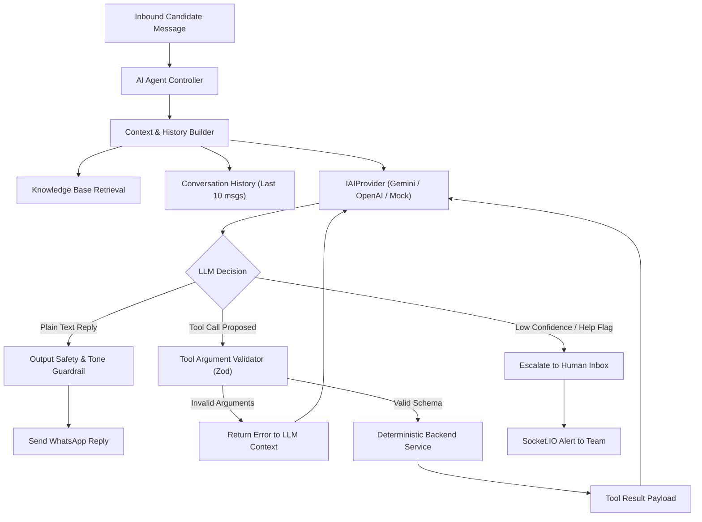

# AI agent architecture

## Purpose and boundaries

The AI agent provides automated conversational support to candidates and contacts during active workflows. It clarifies instructions, answers common questions using verified knowledge base articles, and triggers deterministic backend actions through approved tool calls.

### Core security boundaries
1. **Zero direct database access**: The LLM never connects directly to MongoDB, Redis, or internal micro-components.
2. **Deterministic tool execution**: The LLM only proposes structured function calls. The backend validates parameters using Zod schemas before executing the request.
3. **No independent record modification**: State mutations (e.g. updating candidate status, changing campaign tags) require validated workflow service calls.
4. **Knowledge isolation**: The agent answers questions exclusively from company-approved knowledge base articles. Unverified claims or external conjectures trigger human escalation.



## Provider abstraction (`IAIProvider`)

The platform defines a provider-agnostic interface:

```typescript
export interface IAIToolDefinition {
  name: string;
  description: string;
  parameters: Record<string, any>; // JSON Schema
}

export interface IAIChatMessage {
  role: 'system' | 'user' | 'assistant' | 'tool';
  content?: string;
  name?: string;
  toolCallId?: string;
  toolCalls?: Array<{
    id: string;
    name: string;
    arguments: Record<string, any>;
  }>;
}

export interface IAIChatOptions {
  messages: IAIChatMessage[];
  tools?: IAIToolDefinition[];
  temperature?: number;
  maxTokens?: number;
}

export interface IAIChatResponse {
  content?: string;
  toolCalls?: Array<{
    id: string;
    name: string;
    arguments: Record<string, any>;
  }>;
  confidenceScore?: number;
  finishReason: 'stop' | 'tool_calls' | 'length' | 'content_filter';
}

export interface IAIProvider {
  chat(options: IAIChatOptions): Promise<IAIChatResponse>;
}
```

### Implementations

#### 1. `MockAIProvider`
Designed for development and automated testing without external API credentials or internet egress:
- Inspects incoming messages for test triggers.
- For survey questions, returns simulated canned responses matching knowledge base fixtures.
- When message contains "survey id", produces a mock tool call `verify_survey_completion`.
- When message contains "agent", "human", or "help", returns a response triggering `request_human_assistance`.

#### 2. `GeminiAIProvider`
Uses Google Gemini API (`@google/genai` or Gemini REST API):
- Uses native Gemini function calling.
- Enforces strict JSON Schema validation.
- Configurable model (e.g. `gemini-1.5-pro` or `gemini-2.0-flash`).

#### 3. `OpenAIAIProvider`
Uses OpenAI official SDK:
- Supports `gpt-4o` / `gpt-4o-mini` with strict tool calling schemas (`strict: true`).

## Approved tool catalog

The AI agent has access only to four whitelisted tools:

### 1. `get_candidate_status`
- **Description**: Retrieves current recruitment application and survey submission status for the conversation contact.
- **Parameters Schema**:
  ```json
  {
    "type": "object",
    "properties": {
      "phone": { "type": "string", "description": "Candidate E.164 phone number" }
    },
    "required": ["phone"]
  }
  ```
- **Backend Service**: `ContactService.getStatus(phone)`. Read-only.

### 2. `verify_survey_completion`
- **Description**: Verifies candidate survey submission against the external spreadsheet source.
- **Parameters Schema**:
  ```json
  {
    "type": "object",
    "properties": {
      "phone": { "type": "string", "description": "Candidate E.164 phone number" },
      "surveyId": { "type": "string", "description": "Survey submission identifier" }
    },
    "required": ["phone", "surveyId"]
  }
  ```
- **Backend Service**: `MicrosoftGraphExcelService.verifyCandidateSurvey(phone, surveyId)`.

### 3. `get_job_details`
- **Description**: Retrieves approved job details, prerequisites, location, and compensation disclosures.
- **Parameters Schema**:
  ```json
  {
    "type": "object",
    "properties": {
      "jobCode": { "type": "string", "description": "Job posting identifier or role title" }
    },
    "required": ["jobCode"]
  }
  ```
- **Backend Service**: `KnowledgeBaseService.getJobDetails(jobCode)`. Read-only.

### 4. `request_human_assistance`
- **Description**: Escalates the current conversation to human operators in the team inbox when questions exceed agent knowledge or the candidate requests human help.
- **Parameters Schema**:
  ```json
  {
    "type": "object",
    "properties": {
      "reason": { "type": "string", "description": "Summary of why human intervention is required" }
    },
    "required": ["reason"]
  }
  ```
- **Backend Service**: `ConversationService.escalateToHuman(conversationId, reason)`.

## Knowledge base retrieval strategy

Before invoking the LLM provider, the `ContextBuilder` prepares the prompt:

1. **System Prompt**: Defines company identity, conversational tone (professional, supportive, concise), and constraints:
   - "Do not provide advice outside company policy."
   - "If survey details do not match or cannot be found, ask the candidate to verify their submission or escalate to a team member."
2. **Context Injection**:
   - Queries `knowledge_bases` using category filtering (e.g. `category: 'recruitment'`) and text search matching the user's latest query.
   - Formats matched articles into a `<knowledge_context>` block.
3. **Turn History**:
   - Injects the last 8 messages between the candidate and the system to maintain conversational context.

## Human handoff policy

Conversations automatically escalate to human operators under the following deterministic conditions:

1. Candidate explicitly submits requests containing keywords: `agent`, `human`, `representative`, `help desk`, `operator`.
2. The AI provider returns a confidence score below `0.60`.
3. The AI agent engages in more than 3 consecutive clarification turns on the same topic without resolution.
4. An external tool call encounters an unrecoverable integration failure (e.g. external survey service unreachable).
5. The candidate expresses severe negative sentiment or dissatisfaction.

Upon escalation:
- The conversation status changes to `human_needed`.
- An event emits through Socket.IO room `inbox:team`.
- Automated replies pause until an agent resolves or manually resets the conversation.

