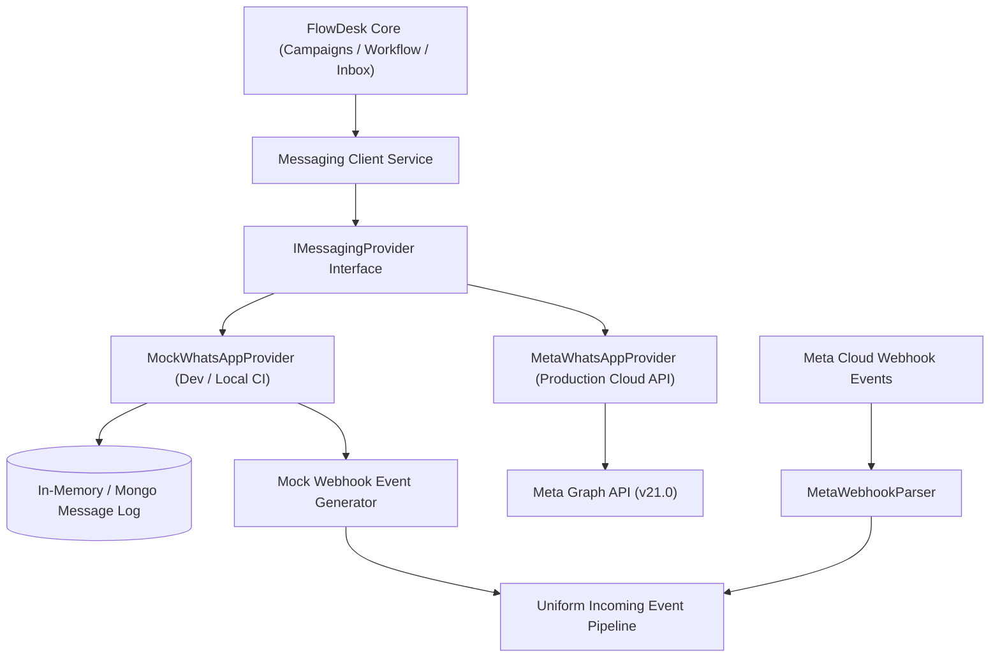

# Messaging architecture

## Provider-independent abstraction

FlowDesk abstracts all messaging operations through the `IMessagingProvider` interface. The core platform never imports Meta SDKs or references external network schemas directly.

Switching between provider implementations requires only updating an environment variable:
```env
MESSAGING_PROVIDER=mock # or "meta"
```



## Provider interface (`IMessagingProvider`)

```typescript
export interface IMessageContent {
  text?: string;
  templateName?: string;
  language?: string;
  templateComponents?: Array<{
    type: 'header' | 'body' | 'button';
    subType?: 'quick_reply' | 'url';
    index?: number;
    parameters: Array<{
      type: 'text' | 'image' | 'document';
      text?: string;
      image?: { link: string };
      document?: { link: string; filename?: string };
    }>;
  }>;
  interactive?: {
    type: 'button' | 'list';
    body: { text: string };
    action: {
      buttons?: Array<{
        type: 'reply';
        reply: { id: string; title: string };
      }>;
      sections?: Array<{
        title: string;
        rows: Array<{ id: string; title: string; description?: string }>;
      }>;
    };
  };
}

export interface ISendResult {
  providerMessageId: string;
  status: 'queued' | 'sent';
  timestamp: Date;
}

export interface IParsedWebhookEvent {
  eventType: 'message' | 'status_update';
  providerMessageId: string;
  fromPhone?: string;
  toPhone?: string;
  timestamp: Date;
  status?: 'sent' | 'delivered' | 'read' | 'failed';
  errorCode?: string;
  errorMessage?: string;
  messageContent?: {
    type: 'text' | 'interactive_reply' | 'media';
    text?: string;
    buttonId?: string;
    mediaUrl?: string;
  };
  rawPayload: any;
}

export interface IMessagingProvider {
  sendMessage(toPhone: string, content: IMessageContent): Promise<ISendResult>;
  verifyWebhookSignature(headers: Record<string, string>, rawPayload: Buffer | string): boolean;
  parseWebhookPayload(payload: any): IParsedWebhookEvent[];
}
```

## Mock WhatsApp provider (`MockWhatsAppProvider`)

The mock provider operates locally without external credentials, network dependencies, or WhatsApp Business Accounts.

### Simulated behaviors
1. **Immediate response**: Generates an instantaneous mock identifier `mock_msg_<uuid>` and returns status `sent`.
2. **Automated status delivery sequence**:
   - At `t + 500ms`: Emits `delivered` status update.
   - At `t + 2000ms`: Emits `read` status update.
3. **Simulation developer API**:
   - `POST /api/v1/mock/whatsapp/incoming`: Simulates a candidate reply from any phone number.
     ```json
     {
       "fromPhone": "+15551234567",
       "text": "YES"
     }
     ```
   - `POST /api/v1/mock/whatsapp/status`: Triggers manual delivery or failure callbacks for automated test suites.
   - `GET /api/v1/mock/whatsapp/outbound`: Inspects the buffer of dispatched mock messages.

## Meta WhatsApp cloud API provider (`MetaWhatsAppProvider`)

Conforms to Meta Graph API v21.0 standards.

### Outbound endpoints
- URL: `https://graph.facebook.com/v21.0/{WHATSAPP_PHONE_NUMBER_ID}/messages`
- Headers:
  - `Authorization: Bearer {WHATSAPP_ACCESS_TOKEN}`
  - `Content-Type: application/json`

### Webhook verification (`GET /api/v1/webhooks/whatsapp`)
- Verifies Meta verification challenge:
  - Query parameters: `hub.mode`, `hub.verify_token`, `hub.challenge`.
  - Compares `hub.verify_token` against `WHATSAPP_WEBHOOK_VERIFY_TOKEN`.
  - Responds with `hub.challenge` string upon match.

### Inbound webhook verification (`POST /api/v1/webhooks/whatsapp`)
- Validates the `X-Hub-Signature-256` header:
  ```javascript
  const expectedSignature = crypto
    .createHmac('sha256', process.env.WHATSAPP_APP_SECRET)
    .update(rawBody)
    .digest('hex');

  const signatureHeader = req.headers['x-hub-signature-256'];
  const isValid = crypto.timingSafeEqual(
    Buffer.from(`sha256=${expectedSignature}`),
    Buffer.from(signatureHeader)
  );
  ```

## Rate limiting and outbound dispatch pipeline

To avoid triggering Meta spam filters and rate limits, outbound dispatches flow through a BullMQ token-bucket queue:

- Default dispatch rate: 20 messages per second.
- Max burst: 50 messages.
- Queue concurrency: 5 worker instances.
- Deduplication: Every outgoing message assigns an idempotency key `msg_send:{campaignId}:{contactId}:{stepId}` in Redis with a 24-hour expiration window.

