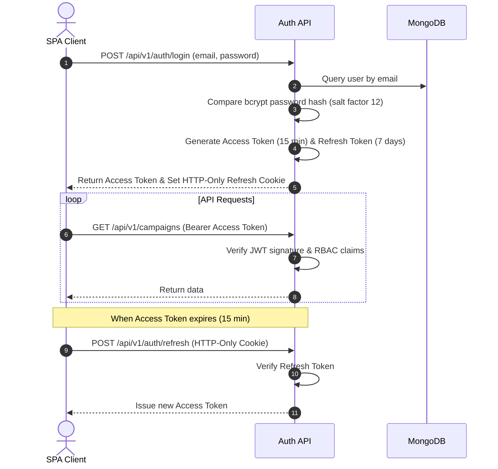

# Security and permissions

## Role-based access control (RBAC)

FlowDesk defines three operational roles:
1. `admin`: Complete administrative control, user account provisioning, integration secret management, system audit log inspection.
2. `manager`: Campaign creation, contact list management, workflow publishing, analytics reporting.
3. `agent`: Team inbox operations, live candidate chatting, manual status updates.

### Permissions matrix

| Module / Operation | Admin | Manager | Agent |
|---|---|---|---|
| User Management: Create / Edit / Deactivate | Yes | No | No |
| Integrations: Configure Graph API & WhatsApp Secrets | Yes | No | No |
| Audit Logs: View System Activity | Yes | No | No |
| Contact Lists: Upload & Import Spreadsheets | Yes | Yes | No |
| Contacts: View / Search Contacts | Yes | Yes | Yes |
| Campaigns: Create / Edit / Launch / Pause | Yes | Yes | No |
| Workflows: Create / Edit / Publish | Yes | Yes | No |
| Team Inbox: View Conversations | Yes | Yes | Yes |
| Team Inbox: Send Direct Messages / Takeover | Yes | Yes | Yes |
| Knowledge Base: Create / Edit Articles | Yes | Yes | No |
| Analytics: View Campaign & Workflow Reports | Yes | Yes | Read-only |

## Authentication architecture



### Password hashing policy
- Algorithm: `bcrypt`.
- Salt work factor: `12`.
- Minimum password length: 10 characters containing at least one uppercase letter, one digit, and one special character.

### Token specifications
- **Access token**:
  - Expiration: 15 minutes.
  - Secret: `JWT_ACCESS_SECRET`.
  - Claims payload: `{ "sub": "<userId>", "email": "<email>", "role": "<role>" }`.
- **Refresh token**:
  - Expiration: 7 days.
  - Stored in an `httpOnly`, `secure`, `sameSite: 'strict'` cookie.

## Webhook verification and signature defense

### Meta WhatsApp Cloud API webhooks
Every inbound webhook from Meta includes an `X-Hub-Signature-256` header containing the HMAC-SHA256 hash of the raw HTTP request body calculated with the Meta App Secret.

The platform validates this signature using constant-time comparison before processing or queuing the payload:

```javascript
import crypto from 'node:crypto';

export function verifyMetaSignature(rawBodyBuffer, signatureHeader, appSecret) {
  if (!signatureHeader || !appSecret) {
    return false;
  }
  const hash = crypto
    .createHmac('sha256', appSecret)
    .update(rawBodyBuffer)
    .digest('hex');
  const expectedBuffer = Buffer.from(`sha256=${hash}`, 'utf8');
  const signatureBuffer = Buffer.from(signatureHeader, 'utf8');

  if (expectedBuffer.length !== signatureBuffer.length) {
    return false;
  }
  return crypto.timingSafeEqual(expectedBuffer, signatureBuffer);
}
```

## Input validation and sanitization

1. **Zod middleware schemas**: All controllers validate request body, query parameters, and route parameters against strict Zod schemas before executing service functions.
2. **Phone number normalization**: Contact numbers undergo E.164 normalization using Google's `libphonenumber-js`. Numbers that fail format validation are quarantined and excluded from campaign lists.
3. **Spreadsheet upload guardrails**:
   - Supported extensions: `.csv`, `.xlsx`, `.xls`.
   - Max file size: 10 MB.
   - Parsing engine: SheetJS configured with safe memory allocation limits.

## Audit logging policy

The platform logs all security-sensitive and operational actions to an append-only collection `audit_logs`:
- User authentication events (successful login, failed attempts, logout).
- Contact imports and batch modifications.
- Campaign creation, execution triggers, and cancellations.
- Team inbox manual message dispatches and agent takeover events.
- Administrative credential updates (with secret values redacted from logged diffs).

