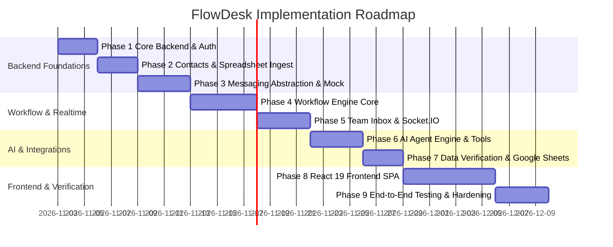

# Development roadmap

## Execution context

This roadmap is designed for a single full-time developer dedicating 6 to 8 hours daily, pair programming with Antigravity. Development follows an iterative milestone strategy: each phase produces working, testable software before subsequent layers are built.

## Milestone schedule

## Phase breakdown and deliverables

### Phase 1: Core backend, database, and authentication
**Estimated effort**: 3 working days
- Set up project directory structure and npm workspaces.
- Configure local developer environment using Docker Compose (MongoDB 7.0 and Redis 7.0).
- Implement database connection management with Mongoose.
- Implement User model, bcrypt hashing, and JWT authentication service (access and refresh tokens).
- Build RBAC middleware protecting routes by role (`admin`, `manager`, `agent`).
- Implement centralized error handling middleware and structured JSON logging.
- **Verification criteria**: Automated Vitest test suite passing for user registration, login, token refresh, and role enforcement.

### Phase 2: Contacts and spreadsheet ingestion
**Estimated effort**: 3 working days
- Implement Contact and ContactList Mongoose schemas.
- Build spreadsheet upload controller accepting CSV and Excel files.
- Implement column header detection and preview generation.
- Implement column mapping parser with E.164 phone normalization (`libphonenumber-js`).
- Build duplicate detection engine (in-batch and database checks).
- Implement contact search and list pagination endpoints.
- **Verification criteria**: Successfully upload a 500-row sample spreadsheet, map columns, and verify deduplicated E.164 records in MongoDB.

### Phase 3: Messaging abstraction and mock WhatsApp provider
**Estimated effort**: 4 working days
- Define `IMessagingProvider` TypeScript interfaces.
- Implement `MockWhatsAppProvider` logging outbound dispatches and simulating delayed callbacks (`delivered`, `read`).
- Implement simulation endpoints: `POST /api/v1/mock/whatsapp/incoming` and `POST /api/v1/mock/whatsapp/status`.
- Build unified webhook ingestion pipeline with signature verification support.
- Implement BullMQ `message-dispatch` queue with rate limiting.
- **Verification criteria**: Outbound messages enqueue and dispatch through the mock provider; simulated replies pass into the webhook pipeline.

### Phase 4: Workflow engine core
**Estimated effort**: 5 working days
- Implement Workflow and WorkflowExecution Mongoose models.
- Implement step execution runners for:
  - `trigger`
  - `send_message` (with variable interpolation)
  - `wait_for_reply` (with regex branch matching and timeout scheduling)
  - `condition`
  - `delay`
  - `update_record`
  - `terminate`
- Set up BullMQ `workflow-execution` worker process.
- Implement atomic execution transitions and idempotency keying.
- Implement Campaign creation and launch controller that enrolls contact lists into workflows.
- **Verification criteria**: Execute an automated two-step campaign where mock contacts receive a message, simulate YES/NO replies, and verify branch progression.

### Phase 5: Team inbox and real-time communication
**Estimated effort**: 4 working days
- Implement Conversation and Message Mongoose models.
- Configure Socket.IO server on Express listener with JWT handshake authentication.
- Implement room-based event broadcasting (`conversation:<id>`, `inbox:team`).
- Build manual message dispatch endpoint for agents.
- Implement conversation takeover and release controllers.
- Build live delivery receipt updater reflecting read statuses in real time.
- **Verification criteria**: Connect two mock browser socket clients; verify incoming messages and agent takeovers sync across both clients without page reload.

### Phase 6: AI agent engine and approved tools
**Estimated effort**: 4 working days
- Implement `IAIProvider` interface with `MockAIProvider` and `GeminiAIProvider` implementations.
- Implement KnowledgeBase Mongoose schema and keyword/text retrieval service.
- Define approved tool schemas: `get_candidate_status`, `verify_survey_completion`, `get_job_details`, `request_human_assistance`.
- Build tool execution sandbox validating arguments via Zod before invoking backend services.
- Implement confidence threshold evaluation and automatic human handoff logic.
- **Verification criteria**: Send candidate queries to AI engine; verify that domain questions receive answers from knowledge base fixtures and unresolvable queries trigger handoff.

### Phase 7: External integrations & verification (Google Sheets, Microsoft Graph, and Database)
**Estimated effort**: 3 working days
- Implement provider-agnostic `IVerificationProvider` supporting Google Sheets, Microsoft Graph Excel, and internal database sources.
- Build Google Sheets reader client querying rows by candidate phone number and survey code.
- Build Microsoft Graph API client using client credentials flow.
- Build Excel Online worksheet reader querying used ranges by phone number and survey code.
- Implement local mock fixture mode for testing without active Azure credentials.
- Implement `verify_data` workflow step handler integrating the Graph API reader.
- Add Redis caching layer (60s TTL) to prevent API throttling during lookups.
- **Verification criteria**: Workflow successfully pauses, queries sample Google Sheets / Excel fixture for matching phone and survey ID, and branches accordingly.

### Phase 8: React 19 frontend SPA
**Estimated effort**: 7 working days
- Scaffold Vite + React 19 + Tailwind CSS v4 single-page application.
- Set up React Router and Zustand authentication and state stores.
- Build responsive layout with sidebar navigation.
- Implement Contact List Manager with interactive spreadsheet column mapping modal.
- Build Campaign Dashboard with real-time dispatch counters.
- Build Team Inbox split-view (conversation list, message thread, candidate sidebar, agent takeover controls).
- Build Knowledge Base article editor.
- Connect Socket.IO client for live updates.
- **Verification criteria**: Operator can log in, import a spreadsheet, create a campaign, and view live incoming messages in the team inbox.

### Phase 9: End-to-end testing, hardening, and deployment preparation
**Estimated effort**: 4 working days
- Create end-to-end recruitment campaign test scenario running from spreadsheet upload to survey verification.
- Implement Audit Log recording across all administrative actions.
- Conduct security audit (rate limiting, header security with Helmet, CORS lockdown).
- Write Dockerfile and docker-compose deployment configuration for production.
- **Verification criteria**: Automated test suite covers critical paths with zero regressions.

