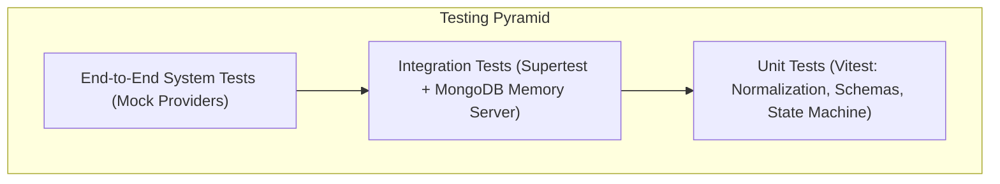
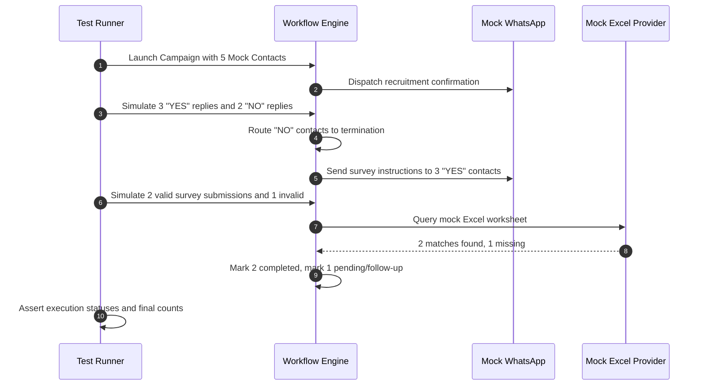

# Testing strategy

## Testing philosophy and scope

FlowDesk enforces a pyramid testing strategy. Business-critical logic - phone normalization, workflow state transitions, webhook signature validation, and AI tool guardrails - must be thoroughly tested with automated test suites before deployment.

Because external APIs (Meta WhatsApp Cloud API, Microsoft Graph, LLM APIs) carry rate limits and external dependencies, the platform relies on in-process mock providers during testing.

## Testing tools

| Category | Tool | Purpose |
|---|---|---|
| Test Runner | Vitest | Fast, native ESM unit and integration testing |
| API Testing | Supertest | HTTP assertion testing against Express routes |
| Database Testing | `mongodb-memory-server` | Ephemeral in-memory MongoDB instance for isolated testing |
| Queue Testing | `ioredis-mock` | In-memory Redis simulation for BullMQ worker tests |
| Assertion Library | Vitest built-in assertions | Type-safe assertions and snapshot testing |

## Test suites and coverage requirements

### 1. Unit tests
- **Phone normalization**:
  - Validates formatting of local Indian (`9876543210` with default prefix `+91`), US, UK, and international E.164 numbers.
  - Verifies rejection of invalid strings (e.g. letters, short numbers, invalid country codes).
- **Spreadsheet parsing**:
  - Tests extraction of headers, detection of blank rows, type casting of numbers and strings.
- **Workflow condition engine**:
  - Tests boolean evaluation for operators: `equals`, `contains`, `regex`, `greater_than`.
  - Verifies deterministic routing based on candidate reply tokens (`YES` vs `NO` vs arbitrary text).
- **AI tool argument validation**:
  - Verifies that Zod schemas reject invalid parameters before executing backend services.

### 2. Integration tests
- **Authentication & RBAC**:
  - Validates user signup, login, password comparison, token expiration, and role restrictions (`admin`, `manager`, `agent`).
- **Webhook pipeline**:
  - Tests signature verification using valid and invalid `X-Hub-Signature-256` HMAC headers.
  - Tests ingestion of inbound text messages and delivery receipts into the database.
- **Contact imports**:
  - Uploads a fixture CSV file; verifies database creation of `ContactList` and `Contact` documents.
  - Verifies that duplicate phone numbers are safely counted and skipped.

### 3. End-to-end workflow tests
Simulates the complete recruitment and survey workflow in memory:

## Test fixtures and mock data

Test fixtures reside in `tests/fixtures/`:
- `sample-candidates.csv`: 20 rows of candidate data with mixed formatting and intentional duplicate rows.
- `sample-candidates.xlsx`: Excel workbook formatted with multi-column headers.
- `mock-survey-sheet.json`: Mock response data mirroring Microsoft Graph Excel worksheet range queries.
- `meta-webhook-payloads.json`: Captured raw payloads from Meta WhatsApp Cloud API (text messages, delivery receipts, read receipts).

## CI quality gates

Before merging code or preparing a release:
1. All Vitest tests must pass (`vitest run`).
2. Code coverage must meet the following minimum thresholds:
   - Workflow engine services: 85%
   - Phone normalization and contact mapping: 90%
   - Messaging providers and webhooks: 80%
   - API controllers: 75%
3. Lint and type-checking must pass with zero errors (`tsc --noEmit` and `eslint .`).

